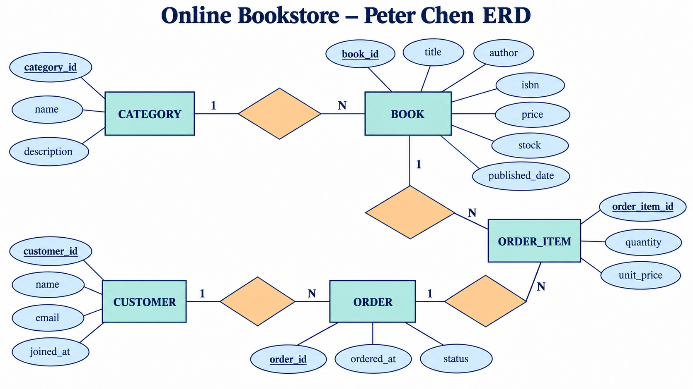
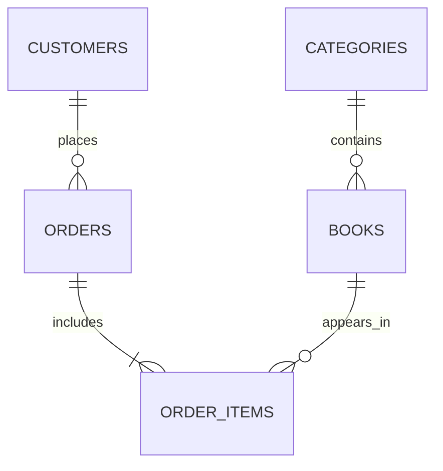

# B6-1 데이터베이스와 백엔드

이 폴더는 B6-1 미션 제출물을 관리하는 작업 공간이다.

구현 도메인은 **온라인 서점 주문 관리**이며 SQLite 3을 사용한다. 카테고리, 고객, 도서, 주문, 주문 항목의 5개 테이블과 관계를 설계하고 샘플 데이터 및 핵심 쿼리 15개를 작성했다.

## 제출물 구조

```text
b6-1/
├── .gitignore
├── README.md
├── assets/
│   └── online-bookstore-peter-chen-erd.png
├── sql/
│   ├── schema.sql
│   ├── sample_data.sql
│   └── queries.sql
├── results/
│   ├── query_results.txt
│   └── validation.txt
└── bookstore.db         # 명령 실행 시 생성되는 SQLite DB
```

## 데이터 모델

### Peter Chen 표기법 ERD



사각형은 엔터티, 마름모는 관계, 타원은 속성을 나타낸다. 밑줄 속성은 기본키(PK)이며, 관계선의 `1`과 `N`은 일대다 관계를 뜻한다. 관계로 표현된 외래키(FK)는 개념적 ERD에서 중복 표기하지 않았다.

### 관계 요약



- `categories` 1:N `books`
- `customers` 1:N `orders`
- `orders` 1:N `order_items`
- `books` 1:N `order_items`
- 주문 삭제 시 해당 주문 항목은 `ON DELETE CASCADE`로 함께 삭제된다.
- 참조 중인 카테고리, 고객, 도서는 `ON DELETE RESTRICT`로 보호된다.

### 데이터를 나눈 이유

스프레드시트 한 장에도 주문 정보를 기록할 수 있지만, 주문할 때마다 고객 이메일과 도서 제목을 반복해서 적으면 같은 고객이나 도서의 정보가 행마다 달라질 수 있다. 이 프로젝트에서는 고객, 카테고리, 도서처럼 한 번 정의되는 정보와 계속 발생하는 주문 정보를 각각의 테이블로 분리했다. DB의 외래키는 이렇게 나눈 데이터가 실제로 존재하는 대상을 참조하도록 강제하므로, 단순한 셀 목록보다 관계와 무결성을 함께 관리하기 쉽다.

각 테이블의 역할은 다음과 같다.

- `categories`: 도서 분류의 이름과 설명을 한 번만 관리한다.
- `customers`: 주문과 별개로 고객의 기본 정보를 관리한다.
- `books`: 도서 정보, 판매 가격, 현재 재고를 관리한다.
- `orders`: 누가 언제 주문했고 현재 상태가 무엇인지 기록한다.
- `order_items`: 한 주문에 포함된 여러 도서와 수량, 주문 당시 가격을 기록한다.

이 구조에서는 한 셀에 하나의 값만 저장하고, 고객이나 카테고리의 설명을 주문 행마다 반복하지 않는다. 따라서 고객 이메일을 변경할 때 여러 주문 행을 함께 수정해야 하는 갱신 이상과, 주문이 없다는 이유로 고객 정보까지 보관할 수 없는 삽입 이상을 피할 수 있다. `order_items`에 주문 당시의 `unit_price`를 별도로 저장한 것은 이후 도서 가격이 바뀌더라도 과거 결제 금액을 유지하기 위한 의도적인 설계다.

### 키와 관계가 나타내는 것

기본키(PK)는 테이블 안에서 한 행을 식별하고, 외래키(FK)는 다른 테이블의 기본키를 참조해 두 행의 관계를 만든다. 예를 들어 `orders.customer_id`는 새 고객을 만드는 값이 아니라, 이미 `customers`에 존재하는 고객을 가리키는 값이다.

- 하나의 카테고리에는 여러 도서가 속할 수 있지만 각 도서는 하나의 카테고리를 참조한다.
- 한 고객은 여러 번 주문할 수 있지만 각 주문은 한 고객에게 속한다.
- 한 주문에는 여러 주문 항목이 들어가지만 각 주문 항목은 한 주문에 속한다.
- 한 도서는 여러 주문에 등장할 수 있으며, 그때마다 별도의 주문 항목으로 기록된다.

존재하지 않는 고객이나 도서를 참조하는 주문 데이터는 FK 제약으로 거부된다. 실제 제약조건과 무결성 검사 결과는 [`results/validation.txt`](results/validation.txt)에서 확인할 수 있다.

### 컬럼 타입과 제약조건

SQLite는 별도의 `DATE` 타입을 강제하지 않으므로 날짜와 시각을 정렬 가능한 ISO 형식의 `TEXT`로 저장했다. `date()`와 `datetime()`을 이용한 `CHECK` 제약으로 `YYYY-MM-DD` 또는 `YYYY-MM-DD HH:MM:SS` 형식인지 확인한다.

`price`와 `unit_price`는 대한민국 원 단위의 금액이며 이 서비스에서는 소수 금액을 사용하지 않으므로 `INTEGER`로 저장한다. 실수형을 사용했을 때 생길 수 있는 부동소수점 오차도 피할 수 있다. 재고와 수량 역시 낱권 단위이므로 `INTEGER`를 사용하고, 음수 재고와 0개 주문이 저장되지 않도록 `CHECK` 조건을 적용했다.

## 주요 조회 흐름

### 주문이 있는 고객과 없는 고객 찾기

Q5는 주문과 고객 양쪽에 연결되는 행이 있어야 결과에 포함되는 `INNER JOIN`을 사용한다. 실행 결과에는 주문이 존재하는 김하늘, 박지우 등의 고객과 주문 정보가 함께 나온다.

Q7은 모든 고객을 먼저 남기는 `LEFT JOIN`을 사용한다. 주문이 없는 고객은 오른쪽 `orders`의 컬럼이 `NULL`이 되므로 `WHERE o.order_id IS NULL` 조건으로 걸러낼 수 있다. 샘플 데이터에서는 주문이 없는 `한유진` 고객 한 명이 반환된다. 즉 `LEFT JOIN` 자체가 왼쪽의 미연결 행만 반환하는 것은 아니며, 연결된 행과 연결되지 않은 행을 모두 남긴 뒤 `NULL` 조건으로 미연결 행을 선택한 것이다.

### 카테고리별 통계

Q9는 같은 `category_id`를 가진 도서를 한 그룹으로 묶는다. `COUNT`는 그룹에 속한 도서 수를 세고, `AVG`는 그 그룹의 가격 평균을 계산한다. 예를 들어 데이터베이스 카테고리의 도서 2권은 하나의 그룹이 되어 `book_count`는 2, `average_price`는 33,000원이 된다. `LEFT JOIN`을 사용했기 때문에 아직 도서가 없는 카테고리도 통계 결과에 남길 수 있다.

### 완료 주문의 고객별 구매 금액

Q10은 여러 관계와 집계를 한 번에 사용하므로 다음 순서로 읽을 수 있다.

1. `customers`와 `orders`를 연결해 주문자를 확인한다.
2. `orders`와 `order_items`를 연결해 주문에 포함된 도서 수량과 가격을 가져온다.
3. `WHERE o.status = 'completed'`로 완료된 주문만 남긴다.
4. `quantity * unit_price`로 각 주문 항목의 금액을 계산한다.
5. 고객별로 그룹을 만들고 `SUM`으로 총 구매 금액을 합산한다.
6. 총 구매 금액이 큰 고객부터 정렬한다.

그 결과 김하늘 고객은 완료 주문 2건의 주문 항목이 합산되어 174,000원으로 나타난다. 전체 Q1~Q15의 실행 결과는 [`results/query_results.txt`](results/query_results.txt)에 기록되어 있다.

### 고객별 주문 검색 인덱스

주문 이력 화면에서는 특정 고객의 주문을 기간순으로 찾는 조회가 반복된다고 가정했다. 이에 맞춰 `orders(customer_id, ordered_at)` 복합 인덱스를 만들었다. 인덱스의 첫 컬럼으로 고객을 좁힌 다음 같은 고객 안에서 날짜 범위를 탐색할 수 있어, 주문 전체를 확인하는 것보다 검색 범위를 줄일 수 있다.

현재 샘플은 주문 12건으로 작아 실행 시간 차이를 수치로 비교하는 것은 의미가 작다. 대신 Q15의 `EXPLAIN QUERY PLAN`에서 SQLite가 해당 인덱스를 사용하는지 확인했으며, 주문 수가 늘어날수록 고객별 이력 조회에서 효과를 기대할 수 있다.

## 실행 방법

`b6-1` 폴더에서 다음 명령을 순서대로 실행한다.

```bash
sqlite3 bookstore.db ".read sql/schema.sql" ".read sql/sample_data.sql"
sqlite3 bookstore.db ".read sql/queries.sql"
```

`schema.sql`은 기존 테이블을 삭제한 뒤 다시 생성하므로 언제든 초기 상태로 재실행할 수 있다. `queries.sql`의 Q13과 Q14는 각각 수정과 삭제를 실제 수행하므로, 결과를 다시 확인하려면 스키마와 샘플 데이터를 먼저 초기화한다.

## 요구사항 충족 현황

- [x] 테이블 5개 및 모든 테이블의 PK
- [x] FK 기반 1:N 관계 4개
- [x] `NOT NULL`, `UNIQUE`, `CHECK`, FK 제약조건
- [x] 각 테이블 샘플 데이터 10행 이상
- [x] 기본 조회 4개
- [x] 조인 4개 (`INNER JOIN`, `LEFT JOIN` 포함)
- [x] 집계 3개 (`COUNT`, `SUM`, `AVG`, `GROUP BY` 포함)
- [x] 서브쿼리 1개
- [x] 수정 및 삭제 2개
- [x] 복합 인덱스 1개와 적용 이유
- [x] 쿼리별 텍스트 실행 결과
- [x] FK 및 DB 무결성 검증
