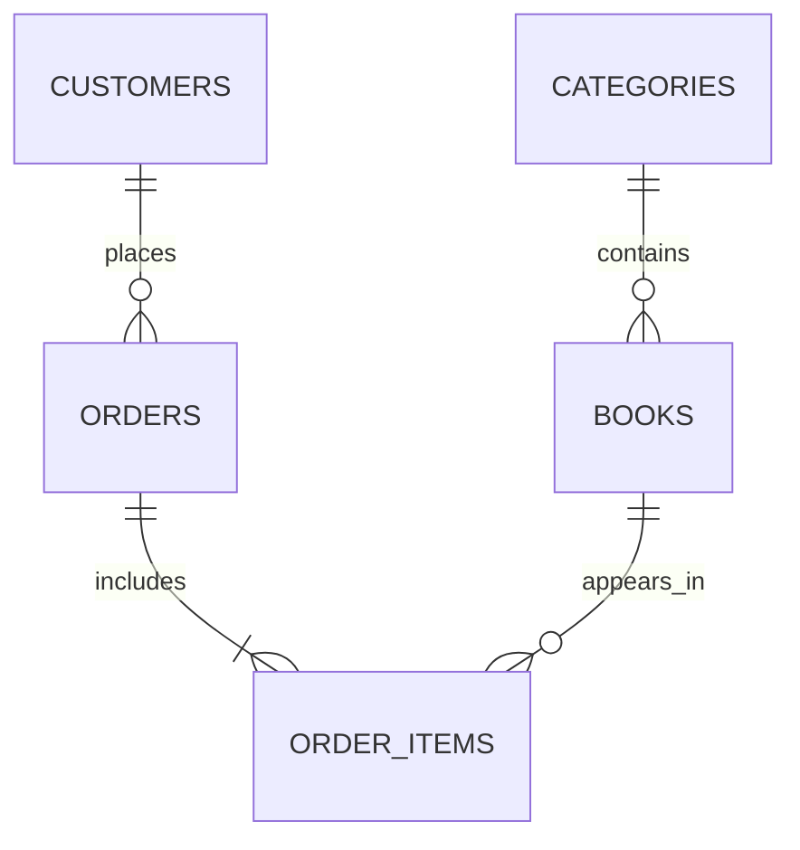

# B6-1 데이터베이스와 백엔드

이 폴더는 B6-1 미션 제출물을 관리하는 작업 공간이다.

구현 도메인은 **온라인 서점 주문 관리**이며 SQLite 3을 사용한다. 카테고리, 고객, 도서, 주문, 주문 항목의 5개 테이블과 관계를 설계하고 샘플 데이터 및 핵심 쿼리 15개를 작성했다.

## 제출물 구조

```text
b6-1/
├── .gitignore
├── README.md
├── assets/
│   └── online-bookstore-peter-chen-erd.png
├── sql/
│   ├── schema.sql
│   ├── sample_data.sql
│   └── queries.sql
├── results/
│   ├── query_results.txt
│   └── validation.txt
└── bookstore.db         # 명령 실행 시 생성되는 SQLite DB
```

## 데이터 모델

### Peter Chen 표기법 ERD


사각형은 엔터티, 마름모는 관계, 타원은 속성을 나타낸다. 밑줄 속성은 기본키(PK)이며, 관계선의 `1`과 `N`은 일대다 관계를 뜻한다. 관계로 표현된 외래키(FK)는 개념적 ERD에서 중복 표기하지 않았다.

### 관계 요약



- `categories` 1:N `books`
- `customers` 1:N `orders`
- `orders` 1:N `order_items`
- `books` 1:N `order_items`
- 주문 삭제 시 해당 주문 항목은 `ON DELETE CASCADE`로 함께 삭제된다.
- 참조 중인 카테고리, 고객, 도서는 `ON DELETE RESTRICT`로 보호된다.

## 실행 방법

`b6-1` 폴더에서 다음 명령을 순서대로 실행한다.

```bash
sqlite3 bookstore.db ".read sql/schema.sql" ".read sql/sample_data.sql"
sqlite3 bookstore.db ".read sql/queries.sql"
```

`schema.sql`은 기존 테이블을 삭제한 뒤 다시 생성하므로 언제든 초기 상태로 재실행할 수 있다. `queries.sql`의 Q13과 Q14는 각각 수정과 삭제를 실제 수행하므로, 결과를 다시 확인하려면 스키마와 샘플 데이터를 먼저 초기화한다.

## 요구사항 충족 현황

- [x] 테이블 5개 및 모든 테이블의 PK
- [x] FK 기반 1:N 관계 4개
- [x] `NOT NULL`, `UNIQUE`, `CHECK`, FK 제약조건
- [x] 각 테이블 샘플 데이터 10행 이상
- [x] 기본 조회 4개
- [x] 조인 4개 (`INNER JOIN`, `LEFT JOIN` 포함)
- [x] 집계 3개 (`COUNT`, `SUM`, `AVG`, `GROUP BY` 포함)
- [x] 서브쿼리 1개
- [x] 수정 및 삭제 2개
- [x] 복합 인덱스 1개와 적용 이유
- [x] 쿼리별 텍스트 실행 결과
- [x] FK 및 DB 무결성 검증
